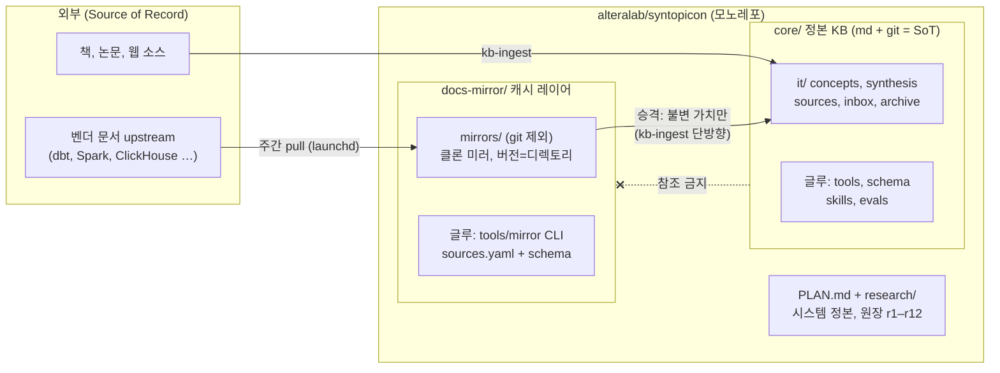
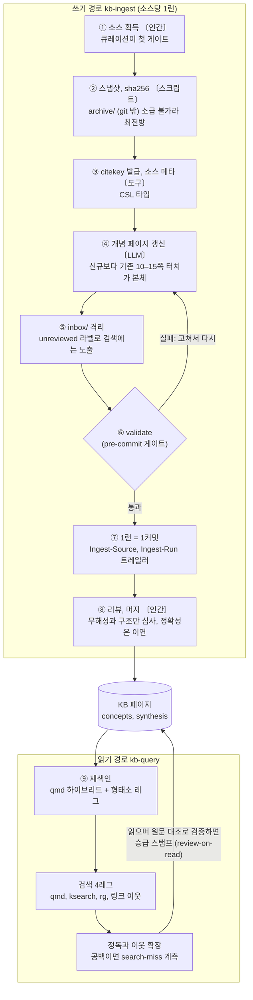
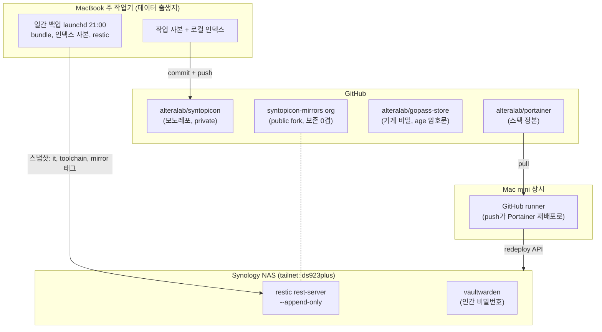

# syntopicon

IT 서적, 논문, 기술 문서를 10–20년 축적하는 개인 지식 시스템 모노레포.

> 이 문서는 지도다. 정본은 [`PLAN.md`](PLAN.md)이며(시스템 구성과 판정 원장 r1–r12),
> 각 레이어의 내부는 그 디렉토리의 PLAN이 정본이라 여기서는 구조만 조망한다.

## 레이어 구조

두 레이어가 한 저장소에 산다. 경계를 지키는 것은 저장소 분리가 아니라 계약이다(원장 r12).
지식은 승격 방향으로만 흐르고, 정본(core)에서 소모품(docs-mirror)을 참조할 수 없다.

## 지식 파이프라인

기계가 쓴 claim은 격리와 라벨로 들어와서, 사람이 읽는 순간마다 조금씩 검증 등급이
올라간다. 전수 검수 대신 이 순환이 정확성을 담당한다.

검색은 색인 파이프라인이 아니라 에이전트가 도구를 고르는 구도라서, 벤더 문서 질의는
`/docs-query`(라우팅, rg, 정독의 무색인 절차)로 넘어간다. 스킬 다섯(`kb-query`,
`kb-ingest`, `kb-lint`, `kb-new`, `docs-query`)은 `~/.claude/skills/` 심링크로
어느 프로젝트에서든 부를 수 있고, 정본은 각 레이어의 `.agents/skills/`에 있다.

## 백업, 보존, 인프라 토폴로지

백업은 데이터가 태어나는 맥북에서 돌고, 상시성이 필요한 것만 상시 기계에 산다.
NAS 서비스는 공유기 포트를 하나도 열지 않는다. 접근은 Tailscale tailnet뿐이다.

| 보존 겹 | 담당 | 막는 위협 |
|---|---|---|
| 0겹 (0원) | GitHub fork(`syntopicon-mirrors`)와 Software Heritage | 미러 upstream 소멸 |
| 백업 3계층 | git bundle, 인덱스 사본, restic에서 NAS(append-only)로 | 로컬 소실, 랜섬웨어 |
| 이연 (트리거: archive 성장) | B2 오프사이트 | 집 단위 재해 (지금 실노출은 archive/뿐) |

비밀은 세 계층으로 나뉜다. 기계 비밀은 gopass(age와 git, exec 주입이라 값이 에이전트
컨텍스트를 우회한다), 사람이 쓰는 비밀번호는 vaultwarden(NAS), 무인 소비분은 파일
사본이다(launchd가 읽는 계층이라 게이트를 걸 수 없다).

## 규약 요지

- 커밋 제목은 `<레이어>/<영역>: 요지`(예 `core/tools:`, `mirror/plan:`, 루트 문서는 `plan:`과 `research:`), 한 커밋은 한 레이어만 만진다
- 게이트는 `git config core.hooksPath core/tools/githooks` 한 번으로 활성화된다(기기당)
- 글루는 자기 레이어 안에 둔다(루트에 종류별 디렉토리 금지, r4와 r12). 구조를 바꾸려면 원장에 근거부터
- 새 기기 복구는 이 저장소를 clone한 뒤 `core/PLAN.md` §5 런북을 따른다

2026-08-09 기준. 세부 수치와 결정 근거는 각 PLAN과 `research/`에 있다.
