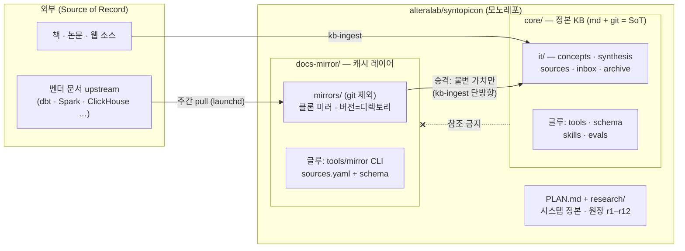
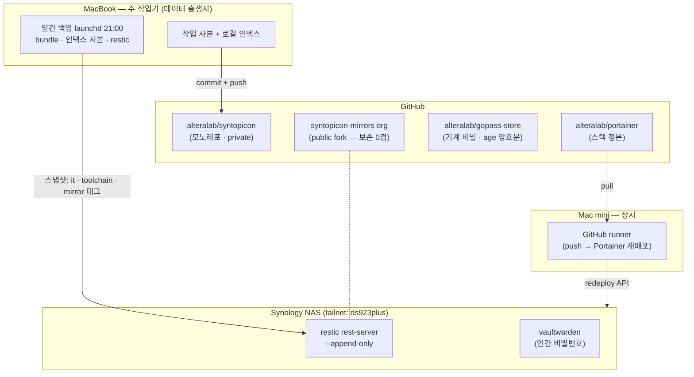

# syntopicon

IT 서적·논문·기술 문서를 **10–20년 축적하는 개인 지식 시스템** 모노레포.

> 이 문서는 지도다 — **정본은 [`PLAN.md`](PLAN.md)**(시스템 구성·판정 원장 r1–r12)이며,
> 각 레이어의 내부는 그 디렉토리의 PLAN이 정본이다. 여기서는 구조만 조망한다.

## 레이어 구조

두 레이어가 한 저장소에 산다. 경계는 저장소가 아니라 **계약**이다(원장 r12) —
지식은 승격 단방향으로만 흐르고, 정본(core)은 소모품(docs-mirror)을 참조하지 않는다.

## 지식 파이프라인 (ingest → 검색)

- 검색은 색인이 아니라 **에이전트가 도구를 고르는 구도** — 벤더 문서 질의는
  `/docs-query`(라우팅→rg→정독, 무색인)로 라우팅된다.
- 스킬 4+1종(`kb-query`·`kb-ingest`·`kb-lint`·`kb-new`·`docs-query`)은
  `~/.claude/skills/` 심링크로 전 프로젝트에서 호출 가능(정본은 각 레이어 `.agents/skills/`).

## 백업·보존·인프라 토폴로지

데이터가 태어나는 곳(맥북)에서 백업이 돌고, 상시성이 필요한 것만 상시 기계에 산다.
NAS 서비스는 공유기 포트 오픈 0 — Tailscale tailnet으로만 접근한다.

| 보존 겹 | 담당 | 막는 위협 |
|---|---|---|
| 0겹 (0원) | GitHub fork(`syntopicon-mirrors`) + Software Heritage | 미러 upstream 소멸 |
| 백업 3계층 | git bundle · 인덱스 사본 · restic → NAS(append-only) | 로컬 소실 · 랜섬웨어 |
| 이연 (트리거: archive 성장) | B2 오프사이트 | 집 단위 재해 (현 실노출 = archive/뿐) |

비밀 계층: **기계 = gopass**(age·git, exec 주입 — 값이 에이전트 컨텍스트를 우회) ·
**인간 = vaultwarden**(NAS) · **무인 = 파일 사본**(launchd 소비, 게이트 불가 계층).

## 규약 요지

- 커밋 = `<레이어>/<영역>: 요지` (예 `core/tools:`, `mirror/plan:`; 루트는 `plan:`·`research:`), 한 커밋 = 한 레이어
- 게이트 = `git config core.hooksPath core/tools/githooks` (기기당 1회)
- 글루는 자기 레이어 안(루트 종류별 디렉토리 금지 — r4·r12), 구조 변경은 원장 근거 필수
- 새 기기 복구: 이 저장소 clone → `core/PLAN.md` §5 런북

2026-08-09 기준. 세부 수치·결정 근거는 각 PLAN과 `research/`를 볼 것.
