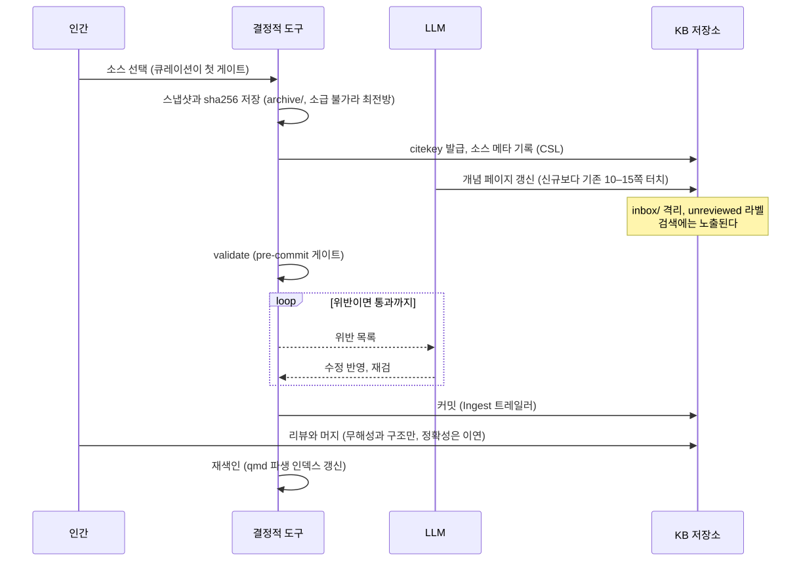
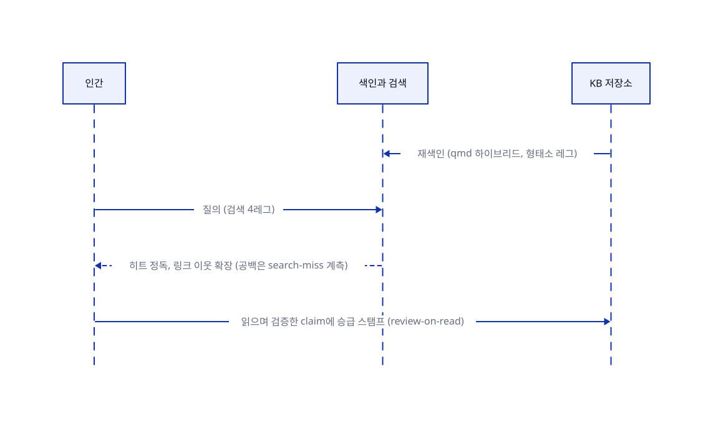

# syntopicon

IT 서적, 논문, 기술 문서를 10–20년 축적하는 개인 지식 시스템 모노레포.

> 이 문서는 지도다. 정본은 [`PLAN.md`](PLAN.md)이며(시스템 구성과 판정 원장 r1–r12),
> 각 레이어의 내부는 그 디렉토리의 PLAN이 정본이라 여기서는 구조만 조망한다.

1. [레이어 구조](#1-레이어-구조)
   1. [core 디렉토리 골격](#11-core-디렉토리-골격)
   2. [schema 계약](#12-schema-계약)
2. [지식 파이프라인](#2-지식-파이프라인)
   1. [쓰기 경로 (kb-ingest)](#21-쓰기-경로-kb-ingest)
   2. [읽기 경로 (kb-query)](#22-읽기-경로-kb-query)
3. [백업, 보존, 인프라 토폴로지](#3-백업-보존-인프라-토폴로지)
4. [규약 요지](#4-규약-요지)
5. [용어 풀이](#5-용어-풀이)

## 1. 레이어 구조

두 레이어가 한 저장소에 산다. 경계를 지키는 것은 저장소 분리가 아니라 계약이다(원장 r12).
지식은 승격 방향으로만 흐르고, 정본(core)에서 소모품(docs-mirror)을 참조할 수 없다.

<picture>
  <source media="(prefers-color-scheme: dark)" srcset="docs/diagrams/layers-dark.svg">
  
</picture>

### 1.1 core 디렉토리 골격

정본은 `core/schema/layout.yaml`, 상세는 `core/PLAN.md` §3.

```
core/
├── PLAN.md
├── schema/
├── tools/
├── evals/
├── .agents/skills/
└── <kb>/
    ├── overview.md
    ├── concepts/
    ├── synthesis/
    ├── sources/
    ├── inbox/
    └── archive/
```

| 경로 | 역할 |
|---|---|
| `PLAN.md` | KB 설계 정본 (결정, 규약, §8 검증 원장) |
| `schema/` | [frontmatter](#5-용어-풀이) 계약과 저장소 경계 (1.2 표 참조) |
| `tools/` | 결정적 CLI (validate, lint, reindex, backup, ksearch …) + githooks |
| `evals/` | 검색 실측 하네스와 [qrels](#5-용어-풀이), 스킬 evals 시나리오 |
| `.agents/skills/` | kb-* 스킬 정본 (`~/.claude/skills` 심링크의 원본) |
| `<kb>/` | KB 인스턴스. kb-new만이 생성하고 KB마다 동형이다 (현재 `it/` 하나). [qmd](#5-용어-풀이) 컬렉션, restic `--tag`, 임계 경보 집계가 모두 이 디렉토리 단위다 |
| `<kb>/overview.md` | 진입 라우터 (Hubs 포인터, 카탈로그 아님) |
| `<kb>/concepts/` | 개념 페이지. 지식의 단위이고, claim은 각주 달린 불릿이다 |
| `<kb>/synthesis/` | 허브와 종합. 허브는 별도 디렉토리가 아니라 링크가 많이 모인 synthesis 페이지다 |
| `<kb>/sources/` | 소스 메타 ([CSL](#5-용어-풀이) 형식, [citekey](#5-용어-풀이)가 파일명) |
| `<kb>/inbox/` | 기계 저작물 격리 (unreviewed 라벨, 리뷰 후 승격) |
| `<kb>/archive/` | 원문 스냅샷. git 제외, restic 담당, 유일하게 대체 불가 |

KB 안에서 디렉토리들이 잇는 관계는 다음과 같다. 실선은 링크와 참조의 사슬이고,
점선은 시간이 지나며 일어나는 이동이다.

<picture>
  <source media="(prefers-color-scheme: dark)" srcset="docs/diagrams/kb-structure-dark.svg">
  
</picture>

두 콘텐츠 계층은 담는 것이 다르다 (정본은 `core/PLAN.md` §4.4 쓰기 정책).

- **concepts는 사실의 계층이다**: 소스가 말한 것을 각주와 함께 기록하고, 페이지 하나가 개념 하나다
- **synthesis는 판단의 계층이다**: 여러 개념을 가로질러 "그래서 어떻다"를 사용자의 관점으로 엮은 것이고, 허브는 그중 링크가 많이 모여 지도 역할을 하는 페이지다
- 경계 기준은 내용의 종합성이 아니라 **provenance**(누가 썼고 누가 승인했나)다
- 기계 초안은 아무리 종합적이어도 inbox에 머물고, 사람이 전문을 읽고 동의해야 synthesis로 승급한다
- 그 승인은 저작 주체의 이전이라 승급 리뷰의 격도 갈린다: concepts 승급은 무해성과 구조만 빠르게(대량 처리), synthesis 승급은 내용 동의까지 느리게(드물게, 전문 읽기)

### 1.2 schema 계약

페이지 타입마다 스키마 하나. 정본 서술은 각 파일의 헤더 주석이고, 이 표는 발췌다.

| 파일 | 검증 대상 | 요지 |
|---|---|---|
| `concept.yaml` | `concepts/` 페이지 | 지식의 단위. claim은 본문의 각주 달린 불릿 |
| `synthesis.yaml` | `synthesis/` 페이지 | 인간 저작 종합과 허브. 경계 기준은 내용이 아니라 [provenance](#5-용어-풀이)다 |
| `source.yaml` | `sources/` 메타 | CSL 타입 10종을 단일 스키마 + type enum으로 (CSL 공식 구조 준거) |
| `guide.yaml` | overview.md, SCHEMA.md | 진입과 설명 문서. 지식 계층이 아니라 sources, verified를 갖지 않는다 |
| `redirect.yaml` | 개명, 병합의 잔여 스텁 | tools/rename이 생성하고 lint가 체인 붕괴를 감시한다 |
| `common.yaml` | (직접 검증 없음) | 공유 정의. per-type 스키마들이 `$ref`로 참조한다 |
| `layout.yaml` | 저장소 경계 | KB 골격의 정본, [동결 코어](#5-용어-풀이). kb-new와 복구 스크립트의 입력 |
| `vocabulary.yaml` | md 본문 (lint의 [AST](#5-용어-풀이) 스캔) | 인라인 폐쇄 어휘 ([epistemic 토큰](#5-용어-풀이) 등). JSON Schema가 아니다 |
| `user-dict.yaml` | 한국어 형태소 색인 | [Kiwi](#5-용어-풀이) 사용자 사전. lint의 파편화 검출이 공급원이고 추측 등재는 금지다 |
| `migrations.md` | (문서) | 스키마 변경 로그. 동결 코어를 바꾸는 유일한 경로다 |

## 2. 지식 파이프라인

### 2.1 쓰기 경로 (kb-ingest)

소스 하나가 1런이고, 1런이 곧 1커밋이다.

<picture>
  <source media="(prefers-color-scheme: dark)" srcset="docs/diagrams/write-path-dark.svg">
  
</picture>

### 2.2 읽기 경로 (kb-query)

<picture>
  <source media="(prefers-color-scheme: dark)" srcset="docs/diagrams/read-path-dark.svg">
  
</picture>

기계가 쓴 claim은 쓰기 경로에서 격리와 라벨로 들어오고, 읽기 경로에서 사람이 읽는
순간마다 조금씩 검증 등급이 올라간다. 전수 검수 대신 이 순환이 정확성을 담당한다.

검색 인덱스의 단위는 KB다 (정본은 `core/PLAN.md` §4.5).

- **KB는 qmd 컬렉션에 1대1 대응**하고, 글로벌 인덱스는 하나다
- KB 안만 찾을 때는 `-c` 필터를 쓰고, 전 KB를 가로지를 때는 스코프 없이 검색한다
- 컬렉션 등록은 kb-new의 기계 단계만이 수행한다
- 글로벌 config(`~/.config/qmd/index.yml`)는 `layout.yaml`에서 재생성되는 파생물이라 커밋도 백업도 하지 않는다
- KB 경계를 넘는 링크는 `qmd://<컬렉션>/<경로>` 문법을 쓰되 비권장이며, edges가 가시화하고 lint가 경고한다

검색은 색인 파이프라인이 아니라 에이전트가 도구를 고르는 구도라서, 벤더 문서 질의는
`/docs-query`(라우팅, rg, 정독의 무색인 절차)로 넘어간다. 스킬 여섯(`kb-query`,
`kb-ingest`, `kb-lint`, `kb-new`, `kb-plain`, `docs-query`)은 `~/.claude/skills/` 심링크로
어느 프로젝트에서든 부를 수 있고, 정본은 각 레이어의 `.agents/skills/`에 있다.

## 3. 백업, 보존, 인프라 토폴로지

백업은 데이터가 태어나는 맥북에서 돈다. NAS는 공유기 포트를 하나도 열지 않고,
접근은 Tailscale tailnet뿐이다.

<picture>
  <source media="(prefers-color-scheme: dark)" srcset="docs/diagrams/topology-dark.svg">
  
</picture>

| 보존 겹 | 담당 | 막는 위협 |
|---|---|---|
| 0겹 (0원) | GitHub fork(`syntopicon-mirrors`)와 Software Heritage | 미러 upstream 소멸 |
| 백업 3계층 | git bundle, 인덱스 사본, restic에서 NAS(append-only)로 | 로컬 소실, 랜섬웨어 |
| 이연 (트리거: archive 성장) | B2 오프사이트 | 집 단위 재해 (지금 실노출은 archive/뿐) |

백업 자격증명 관리와 NAS 컨테이너 배포는 이 시스템이 아니라 홈랩 인프라가 담당한다
(정본은 `alteralab/portainer` 저장소의 런북들).

## 4. 규약 요지

- 커밋 제목은 `<레이어>/<영역>: 요지`(예 `core/tools:`, `mirror/plan:`, 루트 문서는 `plan:`과 `research:`), 한 커밋은 한 레이어만 만진다
- 게이트는 `git config core.hooksPath core/tools/githooks` 한 번으로 활성화된다(기기당)
- 글루는 자기 레이어 안에 둔다(루트에 종류별 디렉토리 금지, r4와 r12). 구조를 바꾸려면 원장에 근거부터
- 새 기기 복구는 이 저장소를 clone한 뒤 `core/PLAN.md` §5 런북을 따른다

## 5. 용어 풀이

| 용어 | 풀이 |
|---|---|
| frontmatter | 마크다운 파일 머리의 YAML 메타데이터 블록. 페이지의 타입, 출처, 검증 상태를 담는다 |
| qrels | query relevance judgments. 검색 평가용 정답표로, "이 질의의 정답 문서는 이것"을 사람이 미리 판정해 둔 목록이다 |
| CSL | Citation Style Language. 서지 정보(저자, 제목, 출판 연도 등)의 사실상 표준 데이터 형식이다 |
| citekey | 서지 인용 키. `kimball2013`처럼 소스마다 하나 발급되는 식별자로, 같은 소스는 언제나 같은 키가 된다 |
| provenance | 유래 정보. 이 내용을 누가(사람 또는 기계) 만들었고 누가 검토했는지의 이력이다 |
| 동결 코어 | 첫 파일을 넣기 전에 확정하고 이후 임의 변경을 금지한 규약 묶음. 바꾸려면 migrations.md를 거쳐야 한다 |
| AST | abstract syntax tree. 문서를 문자열이 아니라 구조(제목, 불릿, 링크 등의 트리)로 파싱한 결과로, 정규식 검사보다 오검출이 적다 |
| epistemic 토큰 | 지식의 확실성 등급을 나타내는 인라인 표식. `#hypothesis`(가설), `#speculation`(추측) 같은 폐쇄 어휘만 허용된다 |
| Kiwi | 한국어 형태소 분석기. 조사와 활용형을 분리해 "모델링을"로도 "모델링"이 검색되게 하는 색인의 기반이다 |
| qmd | 로컬 마크다운 검색엔진. 키워드 검색(FTS5)과 의미 검색(임베딩)을 합쳐 쓰고 MCP 서버를 내장한다. 인덱스는 정본에서 전량 재생성할 수 있는 소모품이다 |

<sub>2026-08-10 기준. 세부 수치와 결정 근거는 각 PLAN과 `research/`에 있다.</sub>
