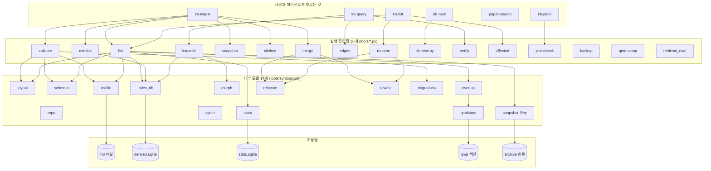
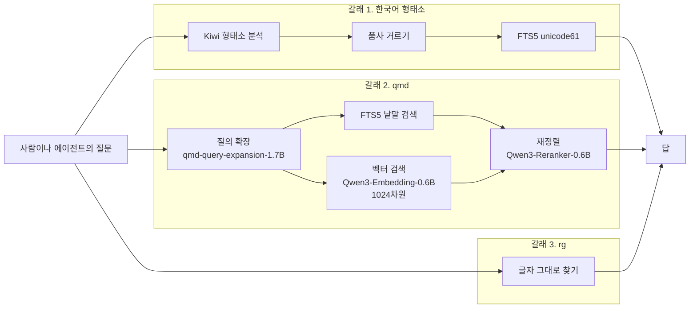
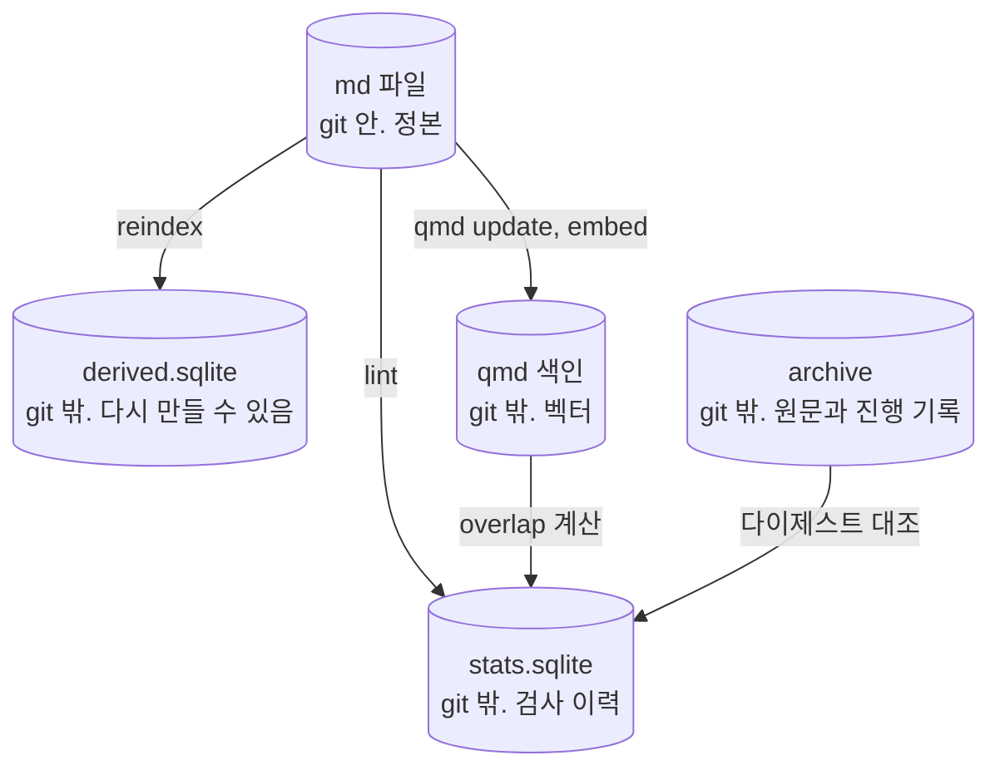

# 전체 관계

## 네 층



읽는 법. 위에서 아래로 기댄다. 스킬은 도구를 부르고, 도구는 모듈을 쓰고, 모듈이
저장물을 만진다. 화살표를 다 그리면 읽을 수 없어서 주된 것만 남겼다.

## 결합 측정

### 모듈을 쓰는 도구의 수

| 모듈 | 쓰는 곳 | 무엇을 담당하나 |
|---|---|---|
| `layout` | 11 | 저장소 경계 판정. 무엇이 KB이고 무엇이 공유 자산인가 |
| `repo` | 10 | git 조회. 파일 목록, 추가 시점 |
| `schemas` | 7 | JSON Schema 적재와 검증기 |
| `mdfile` | 6 | 마크다운을 구문 나무로 읽기 |
| `index_db` | 6 | 파생 인덱스 만들기와 읽기 |
| `snapshot 모듈` | 2 | 원문 다이제스트 계산 |
| `relocate` | 2 | 파일 옮기기 |
| `rewrite` | 2 | 링크 다시 쓰기 |
| `morph` | 2 | 한국어 형태소 분석과 색인 |
| `overlap` | 1 | 페이지 사이 유사도 |
| `stats` | 1 | 검사 결과 적재 |
| `synth` | 1 | 평가용 합성 |
| `migrations` | 1 | 결번 대장 읽기 |
| `qmdstore` | 1 | qmd 색인 파일 열기 (`overlap`만 쓴다) |

위 다섯은 여러 곳이 함께 쓰는 바탕이다. 여기를 고치면 넓게 번진다.

아래 다섯은 한 곳만 쓴다. 한 곳만 쓰는 것이 나쁘다는 뜻은 아니다. 다만 그 모듈을
왜 갈라 두었는지가 문서에 없으면, 나중에 읽는 사람이 합칠지 둘지 판단할 근거가
없다. 점검할 것은 그 근거의 유무다.

### 크기 쏠림

도구 전체가 2911줄인데 `lint.py` 하나가 709줄이다. **전체의 24퍼센트**다.

스킬 전체가 759줄인데 `kb-ingest`가 249줄이다. **전체의 33퍼센트**다.

두 곳이 이 저장소에서 가장 무거운 지점이고, 책임이 너무 크게 잡혔는지를 볼 첫
자리다. 자세한 것은 `02-도구.md`와 `03-스킬.md`에 있다.

## 검색 세 갈래

같은 질문에 서로 다른 방식으로 답하는 길이 셋이다. 하나가 못 잡는 것을 다른
하나가 잡으라고 셋을 둔다.



### 갈래마다 맡은 것

| 갈래 | 잘하는 것 | 못하는 것 |
|---|---|---|
| 형태소 | 조사가 붙거나 활용된 한국어. 복합 명사 | 기호. 코드 펜스 안의 내용 |
| qmd | 낱말이 달라도 뜻이 비슷한 것 | 숫자와 판 번호. 잡음이 섞인다 |
| rg | 글자 그대로. 판 번호, 코드 조각 | 순위가 없다. 조사 변형을 못 잡는다 |

### 모델 셋

qmd가 쓰는 모델이 셋이고 각각 하는 일이 다르다.

| 자리 | 모델 | 쓰임 |
|---|---|---|
| 벡터 만들기 | `Qwen3-Embedding-0.6B` (1024차원) | 문서와 질문을 숫자로 바꾼다 |
| 재정렬 | `Qwen3-Reranker-0.6B` | 후보를 다시 줄 세운다 |
| 질의 확장 | `qmd-query-expansion-1.7B` | 질문을 여러 형태로 늘린다 |

셋 다 `tools/toolchain-pin.yaml`에 sha256으로 고정되어 있고 파일은
`~/.local/share/syntopicon/models/`에 둔다.

**주의할 것이 하나 있다.** `qmd status`가 화면에 보여주는 모델 이름은 실제로 쓰는
모델이 아니다. qmd가 기본값 이름을 박아 넣기 때문이다. 판별은 벡터 차원으로
한다. 1024면 Qwen3이고 768이면 다른 모델이다. 이 함정은 핀 파일 주석에 적어
두었다.

## 저장물 다섯



| 저장물 | 정본인가 | 잃으면 |
|---|---|---|
| md 파일 | 정본이다 | 지식 자체를 잃는다 |
| `derived.sqlite` | 아니다 | `reindex`로 다시 만든다 |
| qmd 색인 | 아니다 | `qmd update`와 `embed`로 다시 만든다 |
| `stats.sqlite` | 아니다 | 검사 이력을 잃는다. 다시 검사하면 된다 |
| `archive` | 원문은 정본이다 | 스냅샷을 잃는다. git 밖이라 restic만이 지킨다 |

마지막 줄이 점검할 자리다. `archive` 안에는 원문 말고도 `_progress.yaml`이 있고,
그 파일은 어디까지 읽었는지를 담는 유일한 기록인데 git 밖이라 변경 이력이 없다.

## 다시 세는 법

```sh
cd /Users/angyojun/workspace/syntopicon/core

# 도구와 모듈 크기
wc -l tools/*.py tools/syntopicon/*.py

# 도구가 기대는 모듈
rg -o 'from syntopicon import [a-z_, ]+' tools/*.py

# 스킬이 부르는 도구
rg -o 'tools/[a-z_-]+\.py' .agents/skills/*/SKILL.md | sort -u

# 벡터 차원 확인
uv run --group index python -c "
import sys; sys.path.insert(0,'tools')
from syntopicon import overlap
v = overlap.load_vectors(('it',))
print(next(iter(v.values())).shape[1])"
```
