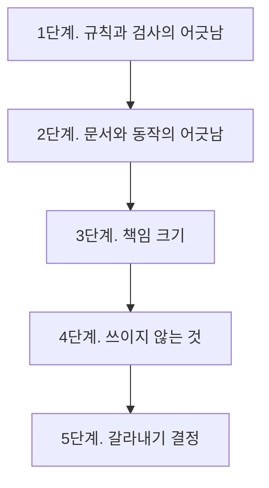

# 점검 계획

## 순서를 이렇게 잡은 이유

무엇을 갈라야 할지 정하려면 갈랐을 때 무엇이 끊기는지를 먼저 알아야 한다. 그래서
관계를 맨 앞에 둔다. 그다음은 크기가 아니라 **위험이 큰 순서**다. 잘못 놔두면
조용히 틀린 답을 내는 것이 먼저이고, 크기만 큰 것은 나중이다.



## 1단계. 규칙과 검사의 어긋남

**왜 먼저인가.** 규칙이 있는데 검사가 없으면 그 규칙은 지켜지지 않는다. 이
저장소에서 이미 두 번 확인됐다. 코드 표기와 목차 형식이 그랬고, 둘 다 성문한 뒤
검사를 붙이고서야 실제로 지켜졌다.

**할 일**

`SCHEMA.md`와 `PLAN.md`가 말하는 규칙을 한 줄씩 뽑고, 그 옆에 그것을 검사하는
곳을 적는다. 세 칸이 나온다.

| 규칙 | 검사하는 곳 | 없으면 |
|---|---|---|
| (규칙 문장) | validate 또는 lint 또는 리뷰 양식 | 빈칸 |

빈칸이 나온 줄이 점검의 산출물이다. 빈칸마다 세 가지 중 하나를 고른다.

- 검사를 붙인다
- 규칙을 지운다
- 검사할 수 없는 것임을 문서에 적는다

셋째가 중요하다. 검사할 수 없는 것을 검사되는 것처럼 두면, 나중에 읽는 사람이
"검사를 통과했으니 맞다"고 잘못 믿는다.

**시작 명령**

```sh
cd /Users/angyojun/workspace/syntopicon/core
rg -o '^\s*- \*\*[^*]+\*\*' SCHEMA.md
rg -o 'Finding\("[a-z-]+"' tools/lint.py | sort -u
rg -o 'error|warn' tools/validate.py | head
```

## 2단계. 문서와 동작의 어긋남

**왜 둘째인가.** 문서가 틀리면 사람과 에이전트가 둘 다 틀린다. 그리고 이 저장소는
문서를 정본으로 삼는 곳이 많아서 파급이 크다.

**할 일. 다음 다섯 자리를 확인한다.**

| 자리 | 물을 것 |
|---|---|
| 스킬이 부르는 명령 | 그 옵션이 도구에 실제로 있는가 |
| 도구가 스스로 밝힌 목적 | 실제로 하는 일과 같은가 |
| 검사가 붙은 규칙 | 검사가 정말 그것을 잡는가. 일부러 깨뜨려 확인 |
| 임계값 | 그 숫자의 근거가 적혀 있는가. 지금 값이 맞는가 |
| 소스 메타의 산문 | 실제 상태와 같은가 |

마지막 줄은 이미 한 번 어긋난 적이 있다. 소스 메타가 아홉 번의 반입만큼 뒤처져
있었고, 그 상태로 재개하면 이미 넣은 것을 다시 넣을 뻔했다. 그래서 재개 지점은
`_progress.yaml`로 옮겼다. **같은 종류의 산문이 다른 곳에도 있는지 보라.**

**이미 알고 있는 어긋남 하나**

`kb-lint`의 임계 경보가 정상 상태를 이상으로 부른다. 승격 직전에는 새 페이지를
가리키는 링크가 깨져 있는 것이 정상인데, 그 상태에서 오류가 50건을 넘어 경보가
울린다. 최근 반입에서 세 번 연속 울렸고 세 번 다 정상이었다.

경보가 늘 울리면 사람이 경보를 무시하게 된다. 그것이 경보의 죽음이다.

## 3단계. 책임 크기

**두 자리가 크다.**

| 자리 | 크기 | 전체 대비 |
|---|---|---|
| `lint.py` | 709줄, 검사 17개, 결과 38가지 | 도구의 24퍼센트 |
| `kb-ingest` | 249줄, 단계 10개, 주체 8종 | 스킬의 33퍼센트 |

**판단할 때 물을 것**

크기 자체는 결함이 아니다. 물을 것은 이것이다.

1. **찾는 데 얼마나 걸리는가.** 이 파일을 열어 자기가 고칠 한 곳을 찾는 데 몇 분
   걸리는가. 오래 걸리면 갈라야 한다.
2. **한 번에 다 읽어야 하는가.** 일부만 읽고도 일할 수 있으면 크기는 문제가 아니다.
3. **갈랐을 때 무엇을 잃는가.** `kb-ingest`를 셋으로 나누면 반입 전체를 보여주는
   문서가 없어진다. 그 그림을 어디에 둘지가 같이 정해져야 한다.
4. **갈랐을 때 무엇이 늘어나는가.** `lint`를 다섯으로 나누면 같은 파일을 다섯 번
   읽거나, 읽은 것을 넘겨주는 장치가 새로 필요하다.

**미리 정해 두면 좋은 것**

가르는 기준을 크기로 잡을지 성격으로 잡을지 먼저 정하라. 크기로 잡으면 다음에
또 커졌을 때 또 갈라야 한다. 성격으로 잡으면 기준이 오래간다.

## 4단계. 쓰이지 않는 것

**세 도구가 어느 스킬에도 불리지 않는다.** `qmd-setup.py`, `backup.py`,
`retrieval_eval.py`이고 합쳐서 673줄이다.

**물을 것**

- 셋이 살림 도구라서 스킬이 없는 것인가. 그렇다면 사람이 언제 돌려야 하는지 아는
  방법이 있는가.
- `retrieval_eval.py`는 마지막으로 언제 돌았는가. 돌지 않는 평가 도구는 코드가
  아니라 문서다.
- `verify.py`가 만드는 `verified` 표시를 쓰는 페이지가 몇 개인가. 0이면 그 절차는
  설계에만 있고 실제로는 없는 것이다.

**모듈 쪽에도 같은 물음이 있다.** 한 곳만 쓰는 모듈이 다섯이다. 갈라 둔 이유가
문서에 없으면, 나중에 읽는 사람이 합칠지 둘지 판단할 근거가 없다.

## 5단계. 갈라내기 결정

앞의 네 단계를 마치면 결정할 것이 남는다. 결정마다 적어 둘 것이 셋이다.

| 적을 것 | 왜 |
|---|---|
| 무엇을 갈랐나 | 나중에 되돌릴 때 필요하다 |
| 왜 갈랐나 | 근거가 없으면 다음 사람이 다시 합친다 |
| 갈라서 잃은 것 | 잃은 것을 적어야 그것을 메울지 판단할 수 있다 |

`PLAN.md`의 §8이 그 기록을 두는 자리다. 이 저장소는 이미 그 방식으로 기각한
설계를 여럿 남겨 두었고, 덕분에 같은 안을 두 번 검토하지 않았다.

## 점검하면서 조심할 것

**목록만 보고 판단하지 말 것.** 이 저장소에서 최근에 세 번 잘못 판단한 적이 있다.
검사 결과 12건을 보고 "구조적인 오탐"이라고 단정했는데, 전체 6786쌍 중 12건으로
분포의 맨 위였다. 목록에는 분모가 없어서 12가 많은지 적은지 알 수 없었다.

그래서 지금은 검사가 분모를 함께 낸다. **다른 곳에도 분모 없는 목록이 있는지
보라.**

**도구가 못 찾은 것과 없는 것을 구분할 것.** 한글 파일 이름을 `ls`와 `grep`으로
찾으면 있는 파일도 0건으로 나온다. 맥이 파일 이름을 자모로 나눠 저장하기 때문이다.
이 함정으로 한 장이 번역서 대조 없이 반입됐다.

**표본 셋으로 단정하지 말 것.** 위 세 번의 오판이 전부 표본 셋에서 나왔다.

## 순서 요약

| 단계 | 하는 일 | 나오는 것 |
|---|---|---|
| 1 | 규칙과 검사를 나란히 놓기 | 검사 없는 규칙 목록 |
| 2 | 문서와 동작 대조 | 어긋난 자리 목록 |
| 3 | 큰 두 자리 판단 | 가를지 말지의 결정 |
| 4 | 안 쓰이는 것 확인 | 지울 것과 남길 것 |
| 5 | 결정 기록 | `PLAN.md` §8에 추가 |

1단계와 2단계는 사실을 모으는 일이라 에이전트에게 시킬 수 있다. 3단계부터는
판단이라 사람이 해야 한다.
