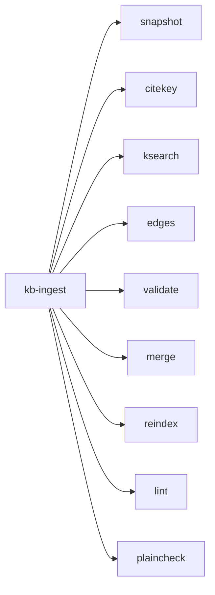
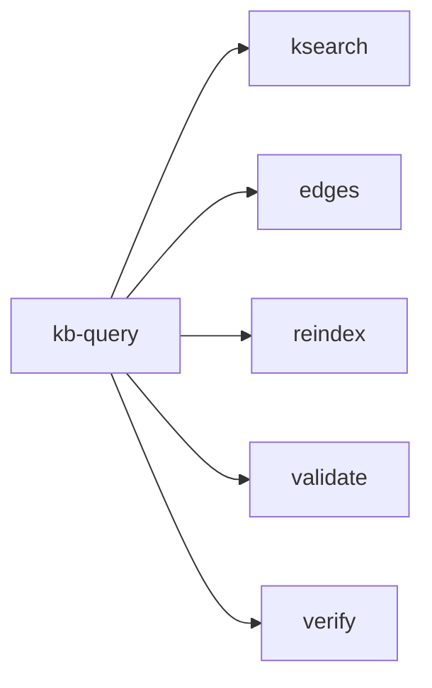
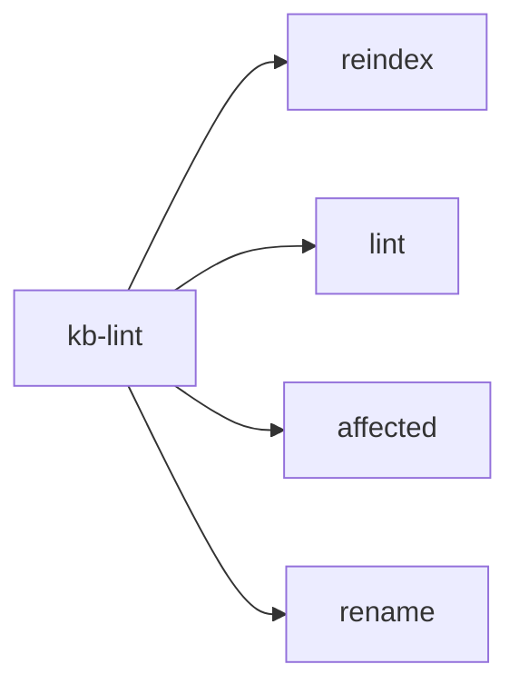
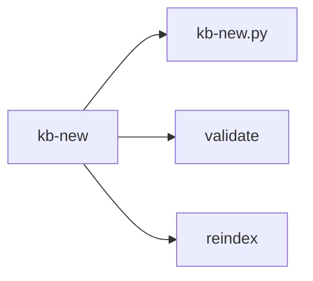
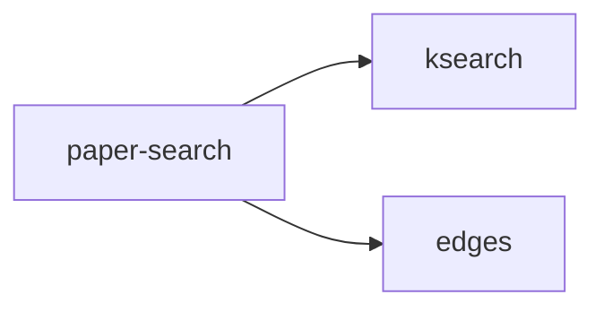
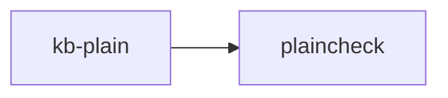
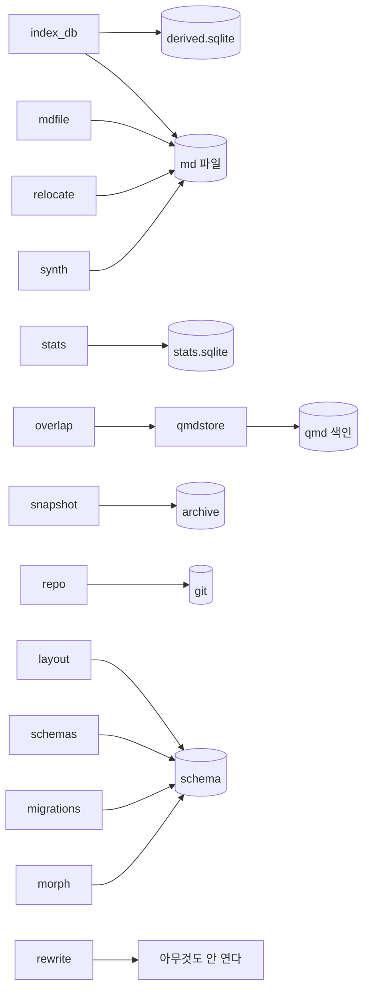

# 스킬마다의 종속

`01-관계.md`의 네 층 그림은 전체를 한 장에 담느라 선이 겹친다. 여기서는 **깊이를
갈라서** 본다. 한 그림에 한 깊이만 두고, 여러 갈래가 겹치는 자리는 그림 대신 표로
쓴다. 표는 선이 겹치지 않는다.

## 세 깊이를 따로 본다

| 깊이 | 무엇에서 무엇으로 | 어디서 보나 |
|---|---|---|
| 1 | 스킬에서 도구로 | 아래 그림 여섯 |
| 2 | 도구에서 모듈로 | 표 하나 |
| 3 | 모듈에서 저장물로 | 그림 하나 |

한 스킬이 무엇을 건드리는지 알려면 세 깊이를 이어 읽는다. 예를 들어 `kb-query`가
`archive`를 건드리는지 보려면, 1에서 그 스킬의 도구를 찾고, 2에서 그 도구들의
모듈을 찾고, 3에서 그 모듈이 `archive`를 여는지 본다.

맨 아래에 그 계산을 미리 해 둔 표가 있다.

## 깊이 1. 스킬에서 도구로

### kb-ingest



아홉이다. 단계 순서로 보면 이렇다.

| 단계 | 부르는 도구 |
|---|---|
| 0 KB 게이트 | `validate` |
| 2 스냅샷 | `snapshot` |
| 3 소스 메타 | `citekey` |
| 4 지식 추출 | `ksearch`, `edges` |
| 6 검사 루프 | `validate` |
| 8 리뷰 | `plaincheck` |
| 9 승격과 재색인 | `merge`, `reindex`, `lint` |

### kb-query



| 단계 | 부르는 도구 |
|---|---|
| 2 횡단 검색 | `ksearch` |
| 3 이웃 확장 | `edges` |
| 7 저장 판단 | `validate`, `reindex` |
| 읽으며 검증 | `verify` |

### kb-lint



### kb-new



### paper-search



### kb-plain



## 깊이 2. 도구에서 모듈로

선이 겹치는 자리라 표로 쓴다. 가로가 모듈, 세로가 도구다. 위에 있을수록 많은
모듈에 기댄다.

| 도구 | index_db | layout | mdfile | migrations | morph | overlap | relocate | repo | rewrite | schemas | snapshot | stats | synth |
|---|---|---|---|---|---|---|---|---|---|---|---|---|---|
| `lint` | O | O | O | | | O | | O | | O | O | O | |
| `kb-new.py` | | O | O | | | | | O | O | O | | | |
| `merge` | | O | O | | | | O | O | O | | | | |
| `rename` | | O | O | | | | O | O | | O | | | |
| `validate` | | O | O | O | | | | O | | O | | | |
| `snapshot` | | O | | | | | | O | | O | O | | |
| `citekey` | | O | | | | | | O | | O | | | |
| `retrieval_eval` | O | | | | O | | | | | | | | O |
| `verify` | | O | O | | | | | O | | | | | |
| `affected` | O | | | | | | | | | O | | | |
| `backup` | | O | | | | | | O | | | | | |
| `ksearch` | O | | | | O | | | | | | | | |
| `qmd-setup` | | O | | | | | | O | | | | | |
| `reindex` | O | O | | | | | | | | | | | |
| `edges` | O | | | | | | | | | | | | |
| `plaincheck` | | | | | | | | | | | | | |

**읽는 법**. `lint` 줄에 O가 여덟이다. 가장 넓게 기댄다. `plaincheck` 줄은 비어
있다. 모듈을 하나도 안 쓰는 유일한 도구다.

**세로로도 읽으라.** `layout` 열에 O가 열하나로 가장 많다. 이 모듈을 고치면 열한
도구가 흔들린다.

## 깊이 3. 모듈에서 저장물로

여기는 선이 적어서 그림으로 본다. **주석이 아니라 실제 여는 코드로 확인한 것만
그렸다.**



**두 자리가 앞 판에서 틀렸다.**

`rewrite`는 파일을 열지 않는다. 문자열을 받아 문자열을 낸다. 파일을 여는 일은
부르는 쪽이 한다. 앞 판에서 이 모듈이 md 파일을 연다고 그렸는데 틀렸다.

`overlap`도 직접 열지 않는다. `qmdstore`를 거친다. 앞 판은 이 한 다리를 건너뛰고
그렸다.

**둘 다 낱말로 찾아서 생긴 잘못이다.** 파일 안에 `qmd`나 `md`라는 낱말이 있으면
연다고 본 것인데, 주석과 상수에도 그 낱말이 있다.

## 스킬이 닿는 저장물

위 세 깊이를 이어서 계산한 결과다. 표로 보면 선이 겹칠 일이 없다.

| 스킬 | md 파일 | derived | stats | qmd 색인 | archive | schema | git |
|---|---|---|---|---|---|---|---|
| `kb-ingest` | O | O | O | O | O | O | O |
| `kb-lint` | O | O | O | O | | O | O |
| `kb-query` | O | O | | | | O | O |
| `kb-new` | O | O | | | | O | O |
| `paper-search` | O | O | | | | O | |
| `kb-plain` | O | | | | | | |

**볼 것**

`kb-ingest`가 일곱 저장물을 전부 건드린다. 나머지 다섯 중 어느 하나도 그렇지
않다. 이것이 이 스킬을 가를지 판단할 때의 재료 하나다.

`kb-plain`은 md 파일 하나만 건드린다. 가장 좁고 가장 독립적이다. 참조 규약으로
뽑아낸 판단이 옳았다는 증거로 읽을 수 있다.

`kb-lint`가 `archive`를 안 건드린다. 그런데 `lint` 도구는 `snapshot` 모듈을 쓰고
그 모듈은 `archive`를 연다. **표가 어긋난 것이 아니라, 그 검사가 스킬 문서에
안내되지 않았다는 뜻이다.** 확인할 자리다.

## 그림 밖에 있는 것

셋이 그림에 안 나온다. 도구가 아니라 바깥 명령이거나 사람이라서다.

| 무엇 | 어디서 쓰나 | 왜 그림에 없나 |
|---|---|---|
| `qmd` 명령 | kb-ingest, kb-query | 저장소 밖 프로그램이다 |
| `git` 명령 | kb-ingest의 커밋 단계 | 사람이나 에이전트가 직접 친다 |
| 사람의 판단 | 모든 스킬 | 도구로 표현되지 않는다 |

**`qmd`가 그림 밖인 것이 위험하다.** 검색의 한 갈래를 통째로 맡는데 우리 쪽
코드로는 `qmdstore` 하나만 그 색인을 연다. 나머지는 **스킬 문서가 사람에게 명령을
치라고 적어 둔 것**이라, 문서로만 이어진 의존이고 검사가 없다.

## 여러 스킬이 함께 쓰는 도구

| 도구 | 부르는 스킬 |
|---|---|
| `reindex` | kb-ingest, kb-query, kb-new |
| `validate` | kb-ingest, kb-query, kb-new |
| `ksearch` | kb-ingest, kb-query, paper-search |
| `edges` | kb-ingest, kb-query, paper-search |
| `lint` | kb-ingest, kb-lint |

**볼 것**. 셋이 부르는 도구가 넷이다. 이 넷은 **출력 형식이 계약**이 된다. 형식을
바꾸면 부르는 쪽이 다 깨지는데 그 계약이 어디에도 적혀 있지 않다.

특히 `ksearch`는 결과 줄의 모양이 계약이다. 지금은 경로와 앵커와 줄번호 뒤에
라벨이 붙는데, 이 모양을 규정한 문서가 없다.

## 다시 만드는 법

```sh
cd /Users/angyojun/workspace/syntopicon/core

# 깊이 1. 스킬이 부르는 도구
rg -o 'tools/[a-z_-]+\.py' .agents/skills/*/SKILL.md | sort -u

# 깊이 2. 도구가 기대는 모듈
uv run python -c "
import re
from pathlib import Path
for p in sorted(Path('tools').glob('*.py')):
    s = p.read_text(); mods = set()
    for m in re.findall(r'from syntopicon import ([^\n]+)', s):
        for part in m.split(','):
            n = part.strip().split(' as ')[0].strip()
            if n: mods.add(n)
    for m in re.findall(r'from syntopicon\.([a-z_]+) import', s): mods.add(m)
    print(p.stem, sorted(mods))"

# 깊이 3. 모듈이 실제로 여는 것
rg -n 'sqlite3.connect|read_text|read_bytes|write_text|subprocess' tools/syntopicon/*.py
```

**세 번째 명령이 중요하다.** 낱말로 찾으면 주석과 상수에도 걸린다. 이 문서의 앞
판이 그렇게 해서 두 곳을 틀렸다. **실제로 여는 함수를 찾아야 한다.**
