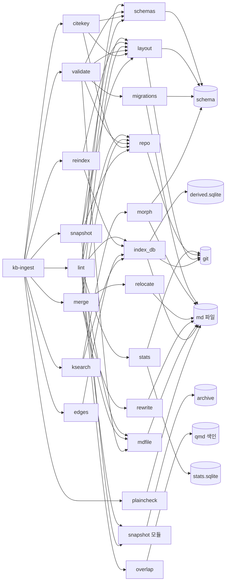
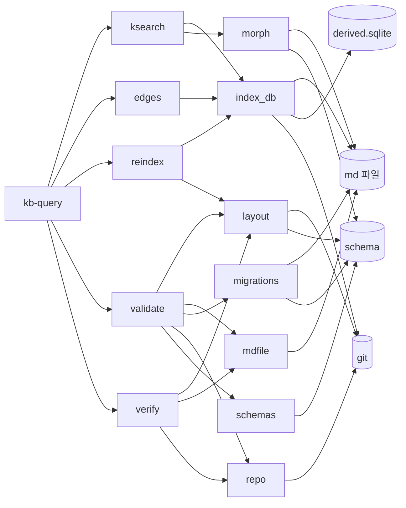
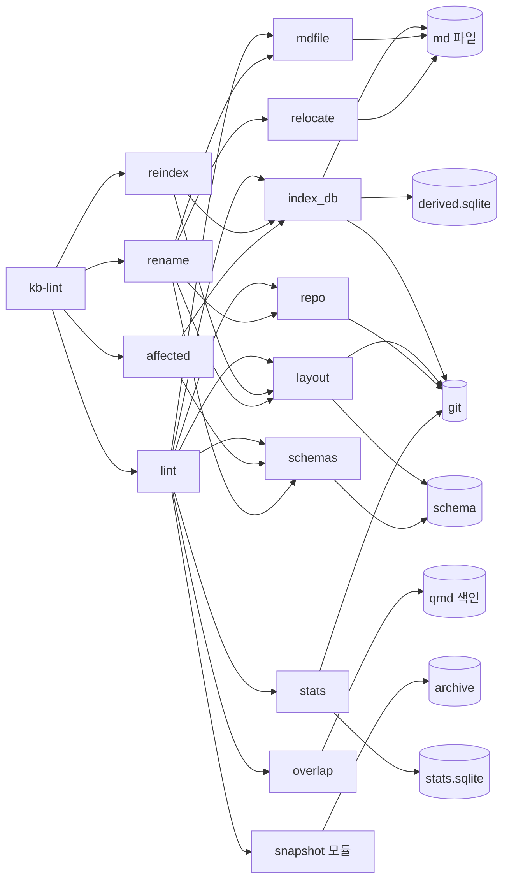
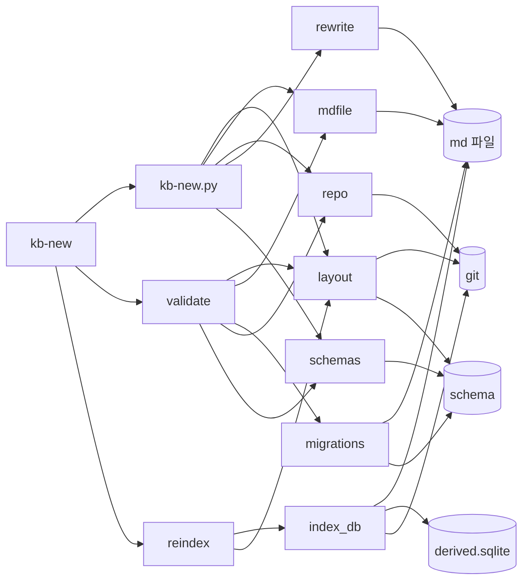
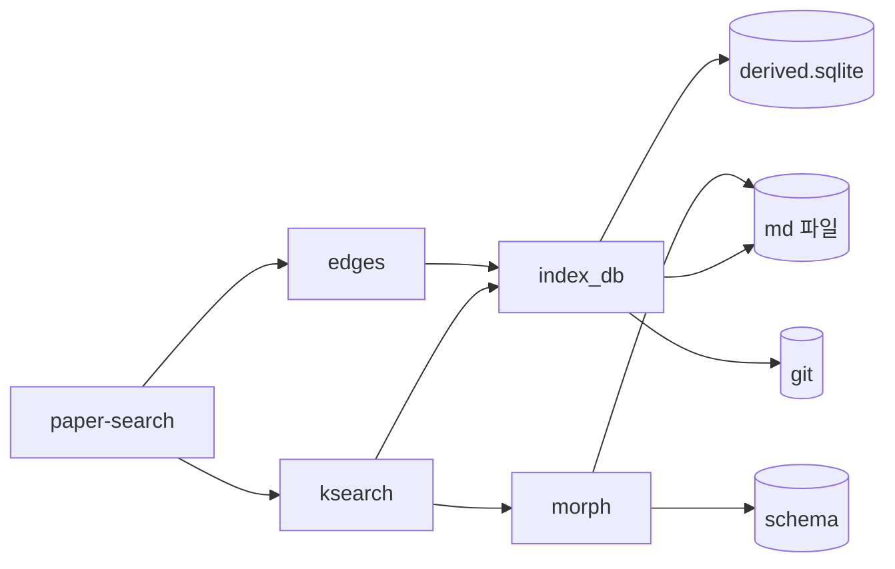
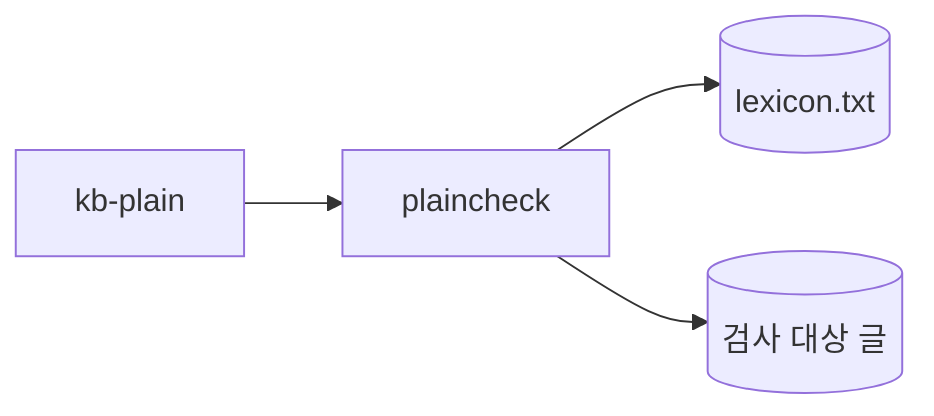

# 스킬마다의 종속 그래프

`01-관계.md`의 네 층 그림은 전체를 한 장에 담느라 화살표를 줄였다. 여기서는 스킬
하나씩 떼어 **그 스킬이 실제로 건드리는 것 전부**를 그린다.

읽는 법은 이렇다. 스킬이 도구를 부르고, 도구가 모듈을 쓰고, 모듈이 저장물을
만진다. 어느 스킬을 고치려 할 때 **무엇이 함께 흔들리는지**를 보는 그림이다.

## 저장물 다섯

그림에 되풀이해 나오므로 먼저 뜻을 적는다.

| 이름 | 무엇인가 | git 안인가 |
|---|---|---|
| md 파일 | 지식 본문과 소스 메타 | 안이다. 정본이다 |
| `derived.sqlite` | 파생 인덱스. 메타 표, 링크, 형태소 | 밖이다. 다시 만들 수 있다 |
| `stats.sqlite` | 검사 이력과 계측 | 밖이다 |
| qmd 색인 | 벡터와 낱말 색인 | 밖이다 |
| `archive` | 원문 스냅샷과 진행 기록 | 밖이다 |
| `schema` | 규격 파일들 | 안이다 |
| git | 이력 조회 | 그 자체다 |

## kb-ingest

부르는 도구가 아홉으로 가장 많다.



**볼 것**

이 한 스킬이 저장물 일곱 가지를 전부 건드린다. 다른 다섯 스킬을 합쳐도 이만큼이
안 된다.

그리고 도구 아홉 중 `lint` 하나가 모듈 여덟을 쓴다. **`kb-ingest`가 무거운 것은
단계가 열이라서만이 아니라 그 안에 가장 무거운 도구가 들어 있기 때문이다.**

## kb-query



**볼 것**

읽기가 본체인 스킬인데 **쓰기 도구가 둘 들어 있다.** `reindex`는 파생 인덱스를
다시 만들고, `verify`는 md 파일의 표시를 바꾼다.

`validate`가 여기 있는 이유도 물을 자리다. 조회하는 스킬이 커밋 게이트를 부르는
것이 맞는가. 저장 판단까지 갔을 때만 쓰는 것이라면 그 조건이 문서에 적혀 있는지
보라.

이 스킬은 **qmd 색인과 `archive`를 건드리지 않는다.** 그런데 문서는 qmd로 검색하라고
말한다. qmd는 도구가 아니라 바깥 명령이라 이 그림에 안 나온다. **그림에 안 나오는
의존이 있다는 뜻이다.**

## kb-lint



**볼 것**

점검하는 스킬인데 **고치는 도구가 하나 들어 있다.** `rename`은 파일을 옮기고 링크를
다시 쓴다.

점검과 수정이 한 스킬에 있는 것이 맞는지 보라. 검사 결과를 보고 바로 고치는 흐름이
자연스럽다는 판단일 수 있고, 아니면 갈라야 할 자리일 수 있다.

## kb-new



**볼 것**

가장 단순한 모양이다. 만들고, 검사하고, 색인한다.

`kb-new.py`가 `rewrite`를 쓴다. KB를 새로 만드는데 링크를 다시 쓸 일이 무엇인지
보라. 라우터 문서에 새 KB를 걸기 때문으로 보이는데, 그 일이 `rewrite`의 담당이
맞는지 물을 자리다.

## paper-search



**볼 것**

가장 얇다. 읽기 도구 둘뿐이다.

이 스킬의 본체는 도구가 아니라 **웹 검색과 판단**이다. 그림에 거의 아무것도 안
나오는 것이 그 증거다. `kb-ingest`에서 갈라낸 판단이 옳았는지를 이 그림이 뒷받침
한다. 도구 의존이 다르면 다른 스킬인 것이 맞다.

## kb-plain



**볼 것**

모듈을 하나도 안 쓰는 유일한 갈래다. `plaincheck`가 홀로 서 있다.

마크다운을 읽으면서 `mdfile`을 쓰지 않는다. 인용과 코드를 건너뛰려면 구문 나무가
필요한데 그것을 따로 구현했다는 뜻이다. **같은 일을 두 곳에서 하고 있는지** 보라.

## 다섯 스킬이 겹치는 자리

| 도구 | 부르는 스킬 수 |
|---|---|
| `reindex` | 3 (ingest, query, new) |
| `validate` | 3 (ingest, query, new) |
| `ksearch` | 3 (ingest, query, paper-search) |
| `edges` | 3 (ingest, query, paper-search) |
| `lint` | 2 (ingest, lint) |

**볼 것**

셋 이상이 부르는 도구가 넷이다. 이 넷은 **출력 형식이 계약**이 된다. 형식을 바꾸면
부르는 쪽이 다 깨지는데, 그 계약이 어디에도 적혀 있지 않다.

특히 `ksearch`는 결과 줄의 모양이 계약이다. 지금은 `경로#앵커:줄번호` 뒤에 라벨이
붙는데, 이 모양을 문서가 규정하지 않는다.

## 그림에 안 나오는 의존

세 가지가 그림 밖에 있다. 도구가 아니라 바깥 명령이거나 사람이라서다.

| 무엇 | 어디서 쓰나 | 왜 그림에 없나 |
|---|---|---|
| `qmd` 명령 | kb-ingest, kb-query | 저장소 밖 프로그램이다 |
| `git` 명령 | kb-ingest의 커밋 단계 | 사람이나 에이전트가 직접 친다 |
| 사람의 판단 | 모든 스킬 | 도구로 표현되지 않는다 |

**볼 것**

`qmd`가 그림 밖인 것이 위험이다. 검색의 한 갈래를 통째로 맡고 있는데, 그 프로그램이
바뀌면 무엇이 깨지는지를 이 그림으로는 알 수 없다.

지금 `qmd`를 만지는 우리 쪽 코드는 `overlap`과 `qmdstore` 둘뿐이고, 나머지는 스킬
문서가 사람에게 명령을 치라고 적어 둔 것이다. **문서로만 이어진 의존이라 검사가
없다.**

## 다시 그리는 법

```sh
cd /Users/angyojun/workspace/syntopicon/core

# 스킬이 부르는 도구
rg -o 'tools/[a-z_-]+\.py' .agents/skills/*/SKILL.md | sort -u

# 도구가 기대는 모듈
uv run python -c "
import re
from pathlib import Path
for p in sorted(Path('tools').glob('*.py')):
    s = p.read_text(); mods = set()
    for m in re.findall(r'from syntopicon import ([^\n]+)', s):
        for part in m.split(','):
            n = part.strip().split(' as ')[0].strip()
            if n: mods.add(n)
    for m in re.findall(r'from syntopicon\.([a-z_]+) import', s): mods.add(m)
    if mods: print(p.stem, sorted(mods))"

# 모듈이 여는 저장물 (주석에 걸리므로 눈으로 확인해야 한다)
rg -n 'sqlite3.connect|open\(|read_text|write_text' tools/syntopicon/*.py
```

마지막 명령은 주의해서 쓰라. 낱말만 찾으면 주석에도 걸린다. 이 문서를 만들 때
`index_db`와 `relocate`가 qmd를 만지는 것처럼 보였으나, 실제로는 링크 문법
`qmd://`를 다루는 상수였다. **낱말이 아니라 실제 여는 코드를 보라.**
